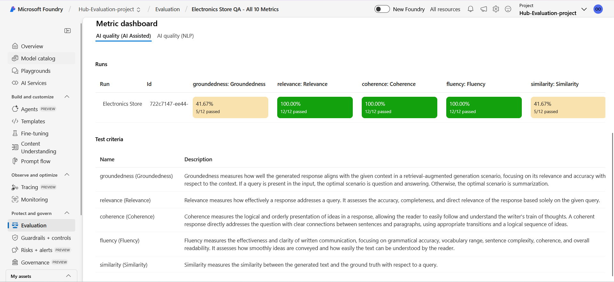
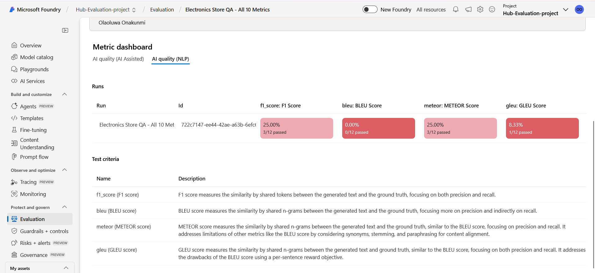

# Electronics Store Return Policy — AI QA Evaluation

A hands-on **AI Quality Assurance (AI QA) and LLM evaluation** project assessing AI-generated customer-support responses against a fictional electronics store's return and refund policy.

Built as an independent learning and portfolio project using **Python**, the **Azure AI Evaluation SDK**, **GPT-4o on Azure OpenAI**, and **Microsoft Azure AI Foundry**. The project adapts evaluation techniques learned from Microsoft's Responsible AI Workshops.

## Project objectives

- Test whether chatbot responses follow documented return and refund rules.
- Compare **AI-assisted quality metrics** with **reference-based NLP metrics**.
- Identify cases where responses sound convincing but are unsupported or incorrect.
- Run repeatable batch evaluations over a structured JSONL dataset and publish the results to Azure AI Foundry.

## Test dataset

The dataset, [`electronics_return_policy_ai_qa.jsonl`](electronics_return_policy_ai_qa.jsonl), contains **12 synthetic test cases**. Some responses are intentionally incorrect to provide realistic evaluation challenges.

Each record includes:

| Field | Description |
|---|---|
| `query` | Customer question or request |
| `response` | Synthetic chatbot answer being evaluated |
| `context` | Authoritative fictional return-policy rules |
| `ground_truth` | Reference answer based on those rules |

Scenarios include opened or used products, defective items, return deadlines, proof-of-purchase requirements, and refund timing and payment methods.

> **Scope:** The responses are synthetic test data. This project evaluates *existing responses*; it does not demonstrate a live customer-support chatbot or a production deployment.

## Evaluation approach

### AI-assisted metrics

Evaluated with GPT-4o through the Azure AI Evaluation SDK:

- **Groundedness** — Is the response supported by the policy context?
- **Relevance** — Does it address the customer query?
- **Coherence** — Is it logically consistent and organized?
- **Fluency** — Is the language clear and natural?
- **Similarity** — Is its meaning similar to the reference answer?

### Reference-based NLP metrics

Computed through text-comparison methods without GPT-4o model calls:

- **F1 Score** — Token overlap balanced by precision and recall
- **ROUGE-1** — Individual-word overlap with the reference
- **BLEU** — Matching word-sequence precision with a brevity penalty
- **METEOR** — Matching words, word forms, synonyms, and order
- **GLEU** — N-gram overlap balancing precision and recall

## Results

The following figures are **pass rates across 12 synthetic test cases**, as shown in the Azure AI Foundry evaluation dashboard. They are *not* overall chatbot accuracy scores.

| Group | Metric | Passed | Pass rate |
|---|---|---:|---:|
| AI-assisted | Groundedness | 5/12 | 41.67% |
| AI-assisted | Relevance | 12/12 | 100.00% |
| AI-assisted | Coherence | 12/12 | 100.00% |
| AI-assisted | Fluency | 12/12 | 100.00% |
| AI-assisted | Similarity | 5/12 | 41.67% |
| NLP | F1 Score | 3/12 | 25.00% |
| NLP | ROUGE-1 | — | — |
| NLP | BLEU | 0/12 | 0.00% |
| NLP | METEOR | 3/12 | 25.00% |
| NLP | GLEU | 1/12 | 8.33% |

## Azure AI Foundry Evaluation Results

The evaluation results were published to Microsoft Azure AI Foundry for tracking and analysis.

### AI-Assisted Evaluation Metrics

### NLP Evaluation Metrics

**Note:** The ROUGE-1 pass rate is not reported in the available dashboard screenshots.

### Key observations

1. **Relevance, Coherence, and Fluency all passed 12/12 cases**, yet **Groundedness passed only 5/12**. Responses can address a question and read well while still not being supported by the source policy.
2. **Similarity passed 5/12**, while several token- and n-gram-based metrics had lower pass rates. These metrics assess different properties and should not be treated as interchangeable.
3. **BLEU passed 0/12 at the configured threshold**. This is a metric-specific finding, not proof that every response was incorrect.
4. Test-case-level analysis is needed to establish whether each automated judgment correctly identifies a policy violation. The aggregate dashboard alone does not establish evaluator accuracy.

## Tools and technologies

Python 3.11 · Jupyter Notebook · VS Code · Docker Dev Containers · Azure AI Evaluation SDK · Azure OpenAI (GPT-4o) · Microsoft Azure AI Foundry · JSONL · pandas · Azure CLI

## Reproducing the evaluation

1. Open this repository in VS Code, preferably using its `.devcontainer/devcontainer.json` configuration.
2. Install dependencies: `python -m pip install -r requirements.txt` (if they were not already installed in the container).
3. Create a **local `.env` file** with your own Azure OpenAI endpoint, deployment name, API key, API version, subscription ID, Foundry project name, and relevant resource-group name. **Never commit `.env` or API keys.**
4. If publishing runs to Azure Foundry, authenticate inside the Dev Container: `az login --use-device-code`.
5. Open the project evaluation notebook, select the container's Python kernel, and run its configuration and evaluation cells.
6. Review the generated local result and, when publishing is enabled and authorized, the evaluation run in the Foundry **Evaluation** dashboard.

> **Costs and reproducibility:** AI-assisted evaluation sends requests to the configured GPT-4o deployment and can incur Azure charges. Model-based scores may vary across reruns, model versions, prompts, or SDK versions.

## Security and responsible use

- `.env`, tokens, and other credentials must not be committed.
- Clear notebook cell outputs or redact any exposed identifiers before publishing.
- All store policies, customer questions, and chatbot responses in the dataset are fictional.
- Metric pass rates are diagnostics, not guarantees of production safety or correctness.

## Acknowledgment

This independent project builds on concepts and tooling from the [Microsoft Responsible AI Workshops](https://github.com/Azure-Samples/RAI-workshops). It is not an official Microsoft project.
